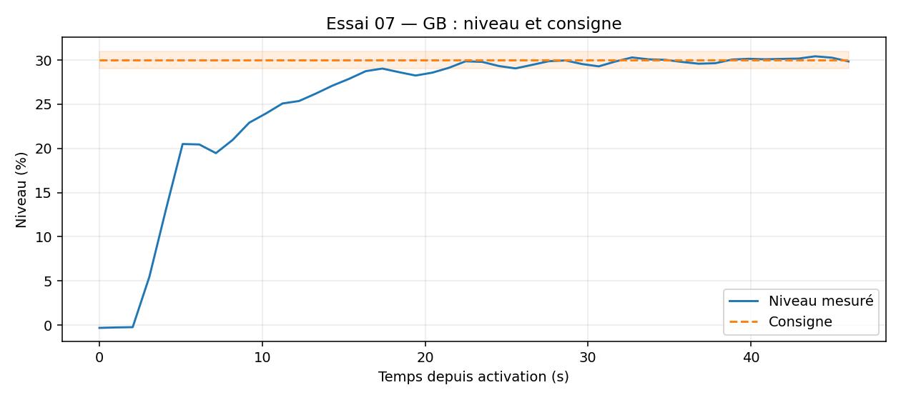
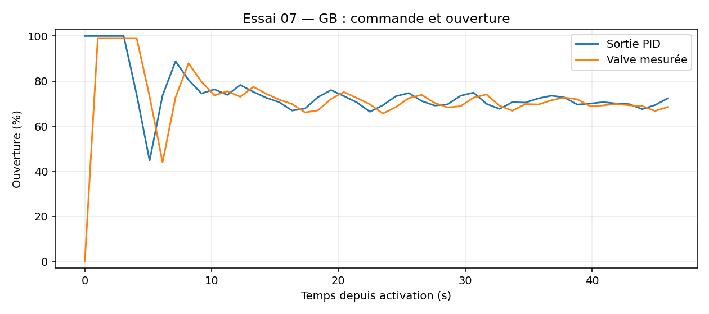
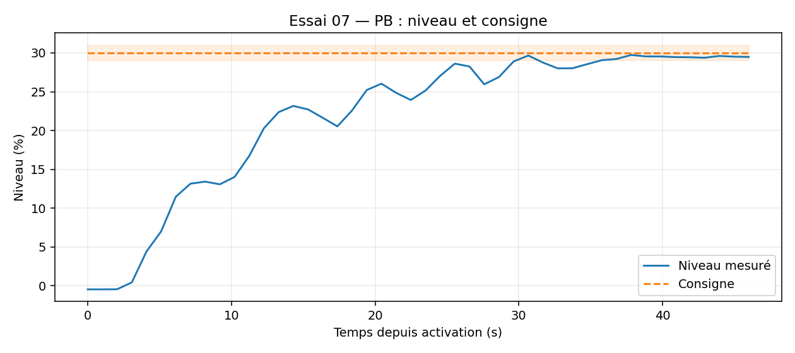
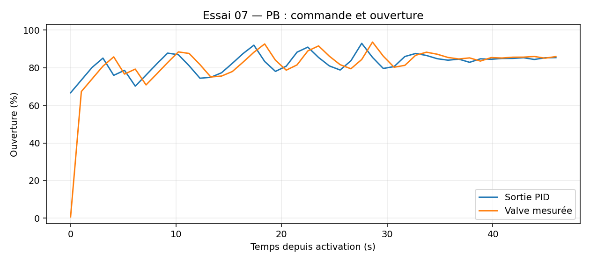

# Essais — panneau RAM

État au 27 novembre 2026. Les résultats ci-dessous proviennent des essais sur le panneau réel, des acquisitions expérimentales et des confirmations de l'opérateur.

## Essais logiciels déjà réalisés

| Essai | Résultat |
|---|---|
| `pid_unitaire` | Réussi |
| `regulation_unitaire` | Réussi |
| `regulation_purge` (dont alarmes) | Réussi |
| `pid_derivation` | Réussi |
| Compilation WSL et ARM | Réussie |
| Compilation après l'ajout de l'acquisition CSV | Réussie |
| Compilation après l'intégration des gains optimisés | Réussie |
| Tests unitaires après l'intégration des gains optimisés | Réussis |

## Essais sur le panneau réel

| Scénario | Résultat observé |
|---|---|
| Communication RS-232 | Lecture des niveaux, température et positions des valves |
| Mode manuel, ouverture GB/PB | Positions proches des commandes; à 25 %, 24,21 % et 25,68 % observés |
| Pompe manuelle | Commandes ON/OFF fonctionnelles |
| Mode automatique | Régulation des deux bassins et changements de consignes observés |
| Consigne zéro | Fermeture observée avec pompe arrêtée |
| Pompe en AUTO | Maintenue active à proximité des consignes lors des essais |
| Purge ouverte isolément | Pas de mesure dédiée documentée |
| Alarme de niveau | ON sans coupure de la pompe ou du PID |
| Génération d'alarme | Environ 3 s (mesure MQTT arrondie) |
| ACK / répétition | Effacement retained, puis ON après 10 s sur GB et PB |
| Arrêt logiciel | Valves proches de 0 %, pompe OFF, commandes bloquées |
| Redémarrage | Mode manuel, pompe OFF, valves proches de 0 %, aucune reprise des anciennes commandes observée |
| Perte MQTT | Message d'erreur, commandes de sécurité acceptées et arrêt du programme |
| Débordement GB | `ALR_GB_OVF ON` à 97 %, maximum publié 98 % |
| Débordement PB | `ALR_PB_OVF ON` à 91 % |
| Réarmement après débordement | Accepté et reprise manuelle confirmée par l'opérateur |
| Perte série en fonctionnement | Non testée physiquement; traitement présent dans le code |
| Publications MQTT | États sur changement observés; nouvel ajout des consignes non testé |
| Acquisition automatique CSV | Fonctionnelle lors des huit essais |
| Optimisation du PID GB | Gains retenus : 5,0 / 0,70 / 3,0 |
| Optimisation du PID PB | Gains retenus : 2,0 / 0,22 / 2,0 |
| Précision GB à 30 % | 10 dernières mesures dans la tolérance de ±1 point |
| Précision PB à 30 % | 10 dernières mesures dans la tolérance de ±1 point |
| Stabilité prolongée de cinq minutes | Non validée |

## Essais expérimentaux du 27 novembre 2026

Huit essais ont été réalisés sur le panneau réel afin d'améliorer la régulation des niveaux des deux bassins. Les données ont été enregistrées automatiquement dans un fichier CSV par le programme.

### Objectifs

- Améliorer le temps de réponse des deux bassins.
- Réduire les oscillations autour des consignes.
- Réduire les écarts lors des changements de consignes.
- Obtenir une précision de ±1 point de pourcentage.
- Observer le comportement des valves de remplissage.
- Comparer les différentes combinaisons de gains PID.

### Résumé des essais

| Essai | Gains GB (Kp / Ki / Kd) | Gains PB (Kp / Ki / Kd) | Objectif |
|---|---|---|---|
| 00 | 5 / 0,70 / 2 | 2 / 0,18 / 1 | Référence initiale |
| 01 | 5 / 0,70 / 2,5 | 2 / 0,22 / 1 | Ajustement des gains |
| 02 | 5 / 0,70 / 3 | 2 / 0,22 / 1,5 | Augmentation des gains dérivés |
| 03 | 5 / 0,70 / 3 | 2 / 0,22 / 2 | Amélioration de la réponse du PB |
| 04 | 5 / 0,70 / 3 | 2 / 0,22 / 2,5 | Vérification d'un Kd plus élevé |
| 05 | 5 / 0,70 / 3 | 1,8 / 0,22 / 2 | Diminution du Kp du PB |
| 06 | 5 / 0,70 / 3 | 2 / 0,22 / 2 | Vérification des gains retenus |
| 07 | 5 / 0,70 / 3 | 2 / 0,22 / 2 | Validation à une consigne de 30 % |

### Résultats de l'essai 07

| Indicateur | GB | PB |
|---|---:|---:|
| Consigne | 30 % | 30 % |
| Dernier niveau mesuré en régulation active | 29,84 % | 29,48 % |
| Erreur absolue moyenne des 10 dernières mesures | 0,218 point | 0,506 point |
| Dernières mesures dans la tolérance de ±1 point | 10/10 | 10/10 |

Aucune alarme ni aucun débordement n'a été enregistré durant l'essai 07.

Les résultats permettent de retenir les gains des essais 03, 06 et 07. Ces gains ont ensuite été intégrés au constructeur de la classe `RegulationBassins`.

### Courbes expérimentales

#### Niveau du grand bassin

#### Commande et ouverture de la valve GB

#### Niveau du petit bassin

#### Commande et ouverture de la valve PB

### Limites des essais

La précision de ±1 point de pourcentage a été observée en fin d'essai pour les deux bassins. La stabilité pendant cinq minutes n'a cependant pas été validée.

Les positions des valves de purge ne sont pas enregistrées dans les acquisitions CSV. Les différences entre certains essais réalisés avec les mêmes gains peuvent donc être liées aux conditions hydrauliques du panneau.

Les résultats complets, les données expérimentales et les graphiques des huit essais sont disponibles dans le [rapport d'optimisation PID](optimisation_pid.md).

## Test sur panneau réel

Les essais doivent être réalisés selon la procédure du laboratoire, après vérification des capteurs, de l'arrêt matériel et du circuit hydraulique. Les journaux de débordement confirment le déclenchement des alarmes et la baisse des niveaux; ils ne contiennent pas les états simultanés de la pompe et des valves. La perte MQTT confirme l'acceptation des commandes de sécurité, mais pas la fermeture physique au moment exact de la panne.

Les résultats détaillés et les courbes des essais précédents sont dans [resultats_essais_26nov.md](resultats_essais_26nov.md).

Les réglages actuels des PID sont documentés dans [reglages_pid.md](reglages_pid.md).

Les résultats des huit essais expérimentaux du 27 novembre sont documentés dans [optimisation_pid.md](optimisation_pid.md).
