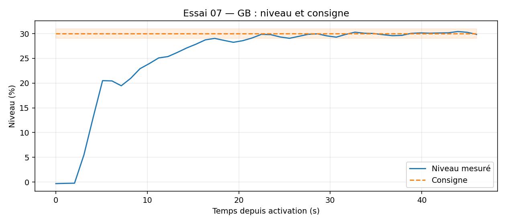
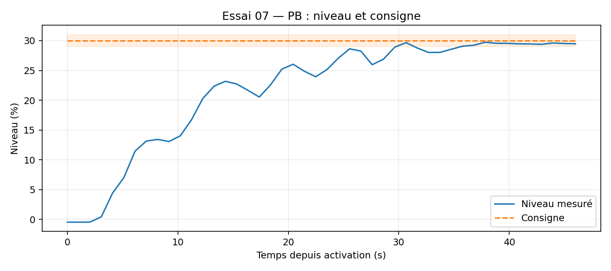

# Réglages du PID — panneau RAM

## But

Réguler indépendamment le niveau du grand bassin (GB) et du petit bassin (PB) par deux PID. Les consignes représentent les niveaux d'eau en pourcentage, et non l'ouverture des valves. La pompe commune reste active en AUTO lorsqu'elle est autorisée et que les conditions de sécurité sont respectées.

## Réglages retenus sur le panneau réel

| Bassin | Kp | Ki | Kd | Limite de sortie |
|---|---:|---:|---:|---:|
| Grand bassin | 5,0 | 0,70 | 3,0 | 0 à 100 % |
| Petit bassin | 2,0 | 0,22 | 2,0 | 0 à 100 % |

Les gains sont intégrés au constructeur de `RegulationBassins`. Le calcul utilise le temps écoulé entre les itérations; la dérivée est calculée sur la mesure.

- `gains gb 5 0.7 3` : modifier les gains GB sans redémarrage.
- `gains pb 2 0.22 2` : modifier les gains PB sans redémarrage.

## Comportement des valves de purge

Les valves de remplissage sont commandées par le Pi. Les valves de purge servent à la sortie de l'eau. Les mesures de position des purges ne sont pas requises par le PID. Lorsque le niveau diminue, le PID peut augmenter la commande de remplissage pour compenser. Lorsque le niveau dépasse la consigne, il réduit la commande; la baisse du niveau dépend de l'écoulement physique. Une consigne nulle force la fermeture de la valve correspondante. La pompe ne s'arrête pas automatiquement à l'atteinte des consignes en AUTO; le circuit doit être adapté à ce fonctionnement.

## Essais et méthode de réglage

Les gains ont été ajustés progressivement à une consigne de 20 %, en observant la vitesse de réponse, les oscillations et la précision. Les essais à deux bassins ont ensuite permis de vérifier des changements de consignes.

### Essais du 26 novembre 2026

| Consigne GB/PB | Niveau GB/PB observé | Écart signé GB/PB |
|---|---|---|
| 30 / 25 % | 29,96 / 25,42 % | -0,04 / +0,42 point |
| 30 / 30 % | 29,78 / 29,47 % | -0,22 / -0,53 point |

Ces mesures sont ponctuelles et ne prouvent pas une précision durable de ±1 point de pourcentage. Les observations de chaque combinaison de gains figurent dans [les résultats des essais](resultats_essais_26nov.md).

### Optimisation du 27 novembre 2026

Un système d'acquisition automatique des données a été ajouté au programme afin d'enregistrer les mesures dans un fichier CSV. Huit essais expérimentaux ont été réalisés sur le panneau réel pour améliorer les réglages des deux PID.

| Essai | Gains GB (Kp / Ki / Kd) | Gains PB (Kp / Ki / Kd) |
|---|---|---|
| 00 | 5 / 0,70 / 2 | 2 / 0,18 / 1 |
| 01 | 5 / 0,70 / 2,5 | 2 / 0,22 / 1 |
| 02 | 5 / 0,70 / 3 | 2 / 0,22 / 1,5 |
| 03 | 5 / 0,70 / 3 | 2 / 0,22 / 2 |
| 04 | 5 / 0,70 / 3 | 2 / 0,22 / 2,5 |
| 05 | 5 / 0,70 / 3 | 1,8 / 0,22 / 2 |
| 06 | 5 / 0,70 / 3 | 2 / 0,22 / 2 |
| 07 | 5 / 0,70 / 3 | 2 / 0,22 / 2 |

Les gains retenus correspondent aux réglages utilisés lors des essais 03, 06 et 07.

### Résultats de l'essai 07

| Indicateur | GB | PB |
|---|---:|---:|
| Consigne | 30 % | 30 % |
| Niveau final | 29,84 % | 29,48 % |
| Erreur absolue moyenne des 10 dernières mesures | 0,218 point | 0,506 point |
| Mesures finales dans la tolérance de ±1 point | 10/10 | 10/10 |

#### Réponse du grand bassin

#### Réponse du petit bassin

Les résultats montrent que les deux bassins atteignent une précision de ±1 point de pourcentage en fin d'essai. Aucun débordement ni aucune alarme n'a été enregistré durant cet essai.

La validation de la stabilité pendant cinq minutes reste à effectuer. Les positions des valves de purge ne sont pas enregistrées dans le fichier CSV.

Pour consulter les données, les graphiques et la comparaison complète des huit essais, voir le [rapport d'optimisation PID](optimisation_pid.md).

## Acquisition des données

Le programme enregistre automatiquement les données dans le fichier `logs/pid_niveaux.csv`.

Le fichier contient notamment :

- Le temps réel entre les acquisitions.
- Les consignes et les niveaux des deux bassins.
- Les erreurs de régulation.
- Les sorties des PID.
- Les ouvertures mesurées des valves.
- Les gains des deux PID.
- L'état de la pompe.
- L'état des alarmes et des sécurités.

Le fichier est réinitialisé à chaque démarrage du programme. Il faut donc sauvegarder les acquisitions avant de redémarrer.

Les acquisitions expérimentales conservées sont disponibles dans le dossier [captures/pid](captures/pid/).

## Sécurité

**Attention :** le code considère un niveau non fini, inférieur à -2 % ou supérieur ou égal à 100 % comme invalide. Les tiges de débordement déclenchent indépendamment la sécurité. Ne pas utiliser de consignes proches du débordement en fonctionnement normal.
